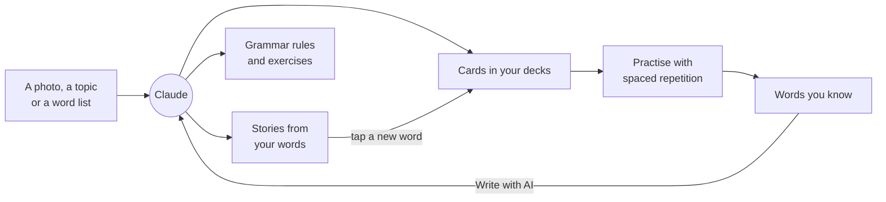

<div align="center">


# Lernzeit

### With AI, learning a language becomes fast and easy.

Give Claude a picture of words, a word list, or just a topic, and you get flashcards.<br />
Lernzeit gives Claude your whole word base and your level, so every story is written with the words and grammar you already know.<br />
You use your words in real reading, and any grammar rule you ask for comes back as a lesson with exercises.


[The method](#the-lernzeit-method) · [Step by step](#how-it-works) · [What you can ask](#what-you-can-ask-claude) · [Get started](#get-started) · [The app](#everything-in-the-app) · [German content](#german-content) · [Privacy](#what-the-ai-can-see) · [Deploy](#deploy-and-install-on-your-phone) · [Shortcuts](#keyboard-shortcuts) · [Project structure](#project-structure)

<br />


</div>

<br />

## The Lernzeit method

> [!TIP]
> **The most important idea in Lernzeit:** you don't learn from a book's word list. You learn from **your own words**, and the AI builds everything around them.

| You give | Lernzeit and Claude give you back |
|---|---|
| 📷 **A picture** of words: a textbook page, a menu, a sign | Flashcards for every word, with article, plural, verb forms, an example sentence and audio |
| 📝 **A word list**, or just **a topic** like *at the doctor* | A full deck on that topic, at your level |
| 📚 **Your whole word base and your level** (Lernzeit sends them for you) | Stories written with the words you know, the grammar you know, and only a few new words |
| ❓ **Any grammar rule**, in plain words: *"Explain the Dativ"* | A lesson with the rule, tables, examples and exercises, each answer explained |

**Why this works**

- **You read real German from day one.** A story you understand almost word for word is easy to read, and reading it is how words stay. Lernzeit shows how much of a story you know, and reading is easy from about 95%.
- **Every new word lands in context.** Each story brings in only a few new words (3 at A1, 5 at A2, 8 at B1), so you meet them in sentences you already understand. Tap one and it becomes a card.
- **Grammar on demand.** No fixed course to wait for: ask about the rule you just met, and practise it on your own nouns and verbs.
- **Nothing is forgotten.** Every card comes back by spaced repetition until you know it, and your time counts toward a daily goal.

## How it works

Claude Desktop or Claude Code connects to Lernzeit through a small [MCP](https://modelcontextprotocol.io) server, so Claude can read your decks and save what it makes straight into the app. The loop:



**1. Words in, from anything.** Paste a photo of a textbook page, a menu or a sign into Claude, give it a list, or just name a topic like *at the doctor*. Claude makes real cards: the article and gender colour, the plural, the verb forms, all six forms of each tense, an example sentence with its English, and an emoji. A word that is already in the deck is skipped.

**2. Practise until it sticks.** Lernzeit asks every card in the directions you pick (picture, English, German or a gap sentence), by typing or by ear, and brings each one back by how well you knew it. A natural German voice reads everything, offline.

**3. Read with the words you know.** In **Stories → Write with AI** you tick your decks and pick a level and a theme. Lernzeit writes a prompt with every word you know or are learning, and only a few new ones (3 at A1, 5 at A2, 8 at B1). Claude writes the story and saves it with a note on every word you may need help with: what it means, why it has this form in this sentence, one more example and a tip. In the reader, your words light up by how well you know them, and a new word becomes a card in one tap.

**4. Ask for any grammar rule.** Say *"Explain the Dativ and give me 12 exercises"*. Claude adds a grammar topic with the rule, tables, examples you can listen to, and exercises of four kinds, each with a one-line *why*. The grammar drills also ask your own words: the genders and plurals of your nouns and the tenses of your verbs, from the cards Claude made.

**5. Speak about your life.** Claude adds speaking questions like the ones in an exam, with a suggested answer. You write your own answer once, then answer from memory and compare.

Everything also works without AI: you can type your own cards, stories, questions and grammar, and the German starter gives you 898 words, 107 stories, 44 questions and 27 grammar topics on day one.

## What you can ask Claude

Once the [AI connection](#get-started) is on, talk to Claude in plain words. Some examples:

| You say | Claude does |
|---|---|
| *(a photo of a textbook page)* "Make cards for the new words in a deck *Kapitel 3*" | Reads the photo, makes the deck and the cards |
| "Make 15 A1 cards about the kitchen" | Nouns with gender and plural, verbs with their forms, a few phrases |
| *(the prompt from Stories → Write with AI)* | Writes a story from your known words and saves it with word notes |
| "Write a short A2 story about a trip to Berlin" | A story with its English translation, paragraph by paragraph |
| "Explain *weil* and *dass* and give me exercises" | A new grammar topic, or more exercises in the one you have |
| "Give me 10 speaking questions about work" | A question set to practise in Questions |
| "Which of my nouns have no plural? Move all food words to a *Food* deck" | Reads your cards and moves them, with their progress kept |
| "Plan my next month for the A2 exam" | Small tasks on the Board, with due dates |
| "Save this explanation as a doc" | A page on Docs to read later |
| "I studied 40 minutes with my teacher today" | Logs the time toward today's goal |

Claude Desktop and Claude Code also offer ready prompts from the server: `make_cards`, `write_story`, `make_questions`, `make_grammar`, `plan_tasks` and `help`. In Grammar, **Ask Claude why** opens a chat with the exercise, your answer and the rule.

## Get started

You need Node 22.18 or newer (the app alone runs on Node 20, but the AI connection and `lz` need 22.18).

```bash
git clone https://github.com/sel-hamr/Lernzeit.git
cd Lernzeit
npm install
npm run dev
```

Open [http://localhost:5173](http://localhost:5173). You sign in with the owner of your Lernzeit cloud, so set that up first (see [Deploy](#deploy-and-install-on-your-phone) and [docs/cloud.md](docs/cloud.md)). The first sign-in on a browser merges what it already has into the cloud, then asks what you want to learn (German, AI or your own topic) and how long a day, and a tour shows each page.

`npm run dev` sends `/api` to the Worker named in [.env](.env). To try it without deploying, run `npm run worker:dev` and `npm run cloud:owner -- --local`, and point `.env.local` at `http://127.0.0.1:8787` ([details](docs/cloud.md#local-development)).

**Connect Claude** in two steps:

1. Run `npm run mcp:setup` (or `lz mcp` once you have [linked `lz`](#the-lz-command)). It adds the Lernzeit server to Claude Code and Claude Desktop and prints a token. If you host Lernzeit, give it the address too:

   ```bash
   npm run mcp:setup -- https://lernzeit.example.workers.dev
   ```

2. In Lernzeit, open **Settings → AI connection**, turn it on and paste the token.

Keep the Lernzeit tab open while you talk to Claude: the server passes each request to that tab, which saves it, and sync sends it to your other devices. An **AI** row in the sidebar shows whether Claude can reach this browser. [docs/mcp-bridge.md](docs/mcp-bridge.md#setup) has the details.

## Everything in the app

- **Daily goals.** A goal in minutes per topic and weekday. The focus timer counts toward it, and so can card reviews, story reading and grammar and question practice (switches in Settings).
- **Your library in your own Cloudflare account, with an offline copy on every device.** One Worker and one D1 database that you deploy yourself hold your cards, sessions, tasks and docs. Each browser keeps a copy in IndexedDB, so it works with no connection and catches up later. A JSON backup takes one click. See [docs/cloud.md](docs/cloud.md).
- **Works offline** and installs on your phone as an app.
- **Always in sync.** Every view reads live queries, so a change shows up at once, even one Claude just made, and in other tabs. Changes reach your other devices within a minute: the newest change to a record wins.
- **Search everything.** Press <kbd>/</kbd> to search your cards, tasks and docs from any page.
- **Turn off what you don't use.** Every page but Today can be switched off in **Settings → Features**. Nothing you saved in it is deleted.
- **A guided start.** A welcome sets up your goals, and a tour shows how each page works and why it helps you remember. **Settings → Tour** runs it again.
- **Light and dark.** Follows your system theme, or pick one.

| Page | What it does |
|---|---|
| **Today** | Progress per topic with time left, today's sessions, flashcard practice time, word of the day, tasks due today |
| **Focus timer** | Countdown, Pomodoro and free mode. Keeps running through a refresh, a closed tab or a sleeping phone |
| **Flashcards** | Your decks, each practised whole in the directions you pick, practice history, word, sentence and cloze cards, typing and listening modes |
| **Grammar** | A course from A1 to B1: 27 topics with the rule, examples and 384 explained exercises of four kinds, a path with progress, and spaced review. Your own topics and words too |
| **Stories** | Short German stories read with your decks: words light up by how well you know them, and any word can become a card |
| **Questions** | German questions like in the speaking part of an exam: write your own answer once, then answer from memory and compare |
| **Docs** | Paste Markdown into nested folders and read it like a README. Pinned and recent docs, tags, read status, search, and it reopens where you stopped |
| **History** | Week calendar, 16-week heatmap, streaks, hours per topic and flashcard stats |
| **Board** | Backlog, To do, Doing and Done, with drag and drop on desktop and touch |
| **Settings** | Goals per weekday, decks, starter content, voice and speed, the AI connection, features on and off, themes, reminders, the tour of the app, backup and restore, sign out |

<details>
<summary><b>Today</b></summary>
<br />

Shows progress per topic with the time left, start buttons, today's sessions, cards due, the word of the day and tasks due today. **Log time** adds study you did away from the timer.

On every page but Flashcards, **Goals today** in the sidebar lists each topic's time against its goal and ends with **Worked today**: all the time you studied today, the running timer and topics without a goal included, against the day's total goal.

</details>

<details>
<summary><b>Focus timer</b></summary>
<br />

- Three modes: countdown (defaults to the time left today), Pomodoro (focus and break lengths are in Settings) and free.
- The timer is stored as timestamps, so it survives a refresh, a closed tab or a sleeping phone.
- Plays a bell at the end and asks *"What did you learn?"*
- A session that runs past midnight is split between the two days.

</details>

<details>
<summary><b>Flashcards</b></summary>
<br />

- Word, sentence and cloze cards (`Der Hund {{spielt}} im Garten.`), coloured by gender: <b>der</b> blue, <b>die</b> red, <b>das</b> green.
- **Deck tabs on one line.** The decks that fit show as tabs, each with its number of cards; the rest sit behind a **3 more** button at the end of the row, which opens a search menu in the middle of the screen: type to find a deck (case, accents and ß don't matter, and decks whose name starts with what you type come first), move with ↑ ↓, open with Enter, close with Esc or a click outside. The open deck always shows as a tab. There are no due counts.
- **Decks in the sidebar.** On Flashcards the sidebar lists your first 5 decks, and always the open one; **9 more decks** opens the same search menu for the rest.
- **Practise a deck.** On a deck's tab, **Practise deck** asks which practice directions to take: Image → German, English → German, German → English or Cloze, each with its number of cards. On **All**, **Practise** does the same for every deck. The session asks every card in those directions, and your rating says when a card comes back: **Again** 3 cards later, **Hard** 8 cards later, **Good** 15 cards later, and **Easy** not again. Each button shows it. The top of the session counts the cards at each rating and how many are left. A card counts once, under its latest rating: rated **Hard** and then **Easy**, it moves from Hard to Easy. The session ends once every card is rated **Easy**, and shows the same counts. Ratings are still kept with FSRS ([ts-fsrs](https://github.com/open-spaced-repetition/ts-fsrs)).
- **Practice history.** Every session is saved after each rating, so one you leave half-way counts too: when it started and ended, the time spent on the cards (at most two minutes a card), the reviews and how many were right, the directions, and the time per deck. The clock button in Flashcards shows them day by day, with totals, the time per deck, and a filter for one deck. Today shows today's practice time, and History the last 30 days'. Sessions are part of backups.
- **Practise the cards you pick.** **Select** in Flashcards turns on select mode: tap cards to tick them, or **Select all** the cards shown. Picks stay when you change the deck or filter, so one round can mix decks. **Practise** asks only those cards, in the order you picked them, in each direction their deck practises, and brings them back by your rating like a deck. **Practise again** at the end repeats the same cards.
- **No word twice in a row.** After a card, the next one is always a different word, even after **Again** or when another direction of the same word is waiting. A word repeats only when it is the last one left in the session.
- **Typing mode** accepts small slips (`ue` for `ü`, a missing umlaut, lowercase, a missing article), then shows the exact spelling and highlights the wrong letters.
- **Listening mode** plays the German and you type what you hear. Speed buttons (0.6×, 0.8×, 1×, 1.2×) sit next to the speaker.
- **Thorsten voice (offline).** A natural German voice that runs on your device, for every speaker button when you learn German: cards, stories and questions. Pick it under Settings → German voice; it downloads once (63 MB) and then needs no internet, key or account. Each clip is made once and saved, and Review makes the next card's audio while you think. The browser voice speaks until the download is done. Voice by Thorsten Müller ([Thorsten-Voice](https://github.com/thorstenMueller/Thorsten-Voice), public domain).
- **Voice** in the sidebar, or the voice name at the top on phones, changes the voice from any page: Thorsten or one of your browser's voices, the same choice as in Settings. Picking Thorsten before it is downloaded opens Settings, where it downloads.
- **Mute** stops the German from playing by itself when the answer is shown. The speaker button still plays it when you tap it. It is the same switch as *Play audio when the answer is shown* in Settings.
- Add images by uploading, pasting with <kbd>Ctrl</kbd>+<kbd>V</kbd> or dropping a file. They are resized to 600 px wide WebP before saving. A card can use an emoji instead, and the editor links to an image search for the word.
- The **+** button quick-adds an English and German pair, tagged `incomplete`.
- Review time can count toward the deck's topic automatically.

</details>

<details>
<summary><b>Grammar</b></summary>
<br />

- A grammar course that stands on its own: 27 topics from A1 to B1 in seven sections (nouns and articles, cases, pronouns, prepositions, verbs, sentences, adjectives). Each has **the rule** with tables, **examples** you can listen to, and 12 to 16 **exercises**: 384 in all.
- **Four kinds of exercise:** fill the gap (pick with <kbd>1</kbd>–<kbd>4</kbd> or type), find the mistake (tap the wrong word), put the words in order (tap them), and write the sentence (rewrite or translate).
- **Every answer is explained.** After each one you read why it is right, such as *helfen takes the dative: dem Mann*, and **Ask Claude why** opens a Claude chat with the exercise, your answer and the rule, for more examples.
- **A path to follow.** Topics are ordered by level with a ring that fills as you learn them; **Continue** takes you to the next one. A topic is mastered when you know 80% of its exercises.
- **Review that keeps it learned.** A wrong answer comes back in the same round and again minutes later; right answers come back after 1, 3, 7, 16, 35 and 75 days. **Start review** mixes everything due from every topic.
- Topics that fit your cards also ask about **your own words**: *Der, die, das* your nouns' genders, *Plural* their plurals, *Präsens*, *Präteritum* and *Perfekt* your verbs in that tense, from the card's **conjugation** (six forms per tense, never built by rules; all 139 starter verbs have one).
- **Add your own** topics and exercises in the editor, in plain text, or let your AI app write them with `add_grammar` (see [AI connection](#get-started)). Starter topics can be edited too.
- `ue` for `ü` and lowercase are accepted, but a missing umlaut is wrong, because *Äpfel* and *fährst* are the point. Active practice time can count toward German. [docs/grammar.md](docs/grammar.md) has the details.

</details>

<details>
<summary><b>Stories</b></summary>
<br />

- Every word that is in one of your decks is highlighted by how well you know it: <b>yellow</b> for new, <b>green</b> for learning, a thin underline once it is known (next review three weeks or more away). Nouns take their gender colour.
- Words are found in their forms too: plurals, verb endings, past tenses from the card's verb forms, adjective endings, *im* for *in*, *ihn* for *er*.
- Tap a word to see its card with the picture, the English and the audio. A word that is not in a deck can be added in one step, with the story's sentence as its example.
- In stories written by AI, the words you need help with explain themselves, and hard words go further: the meaning, why the word has this form in this sentence, one more example, and a tip.
- A bar shows how much of the story you know, are learning, have in a deck but not studied yet, or do not have. Reading is easy from about 95% known.
- Listen to each paragraph, show the English translation under it, and mark the story as read. Active reading time can count toward the story's topic.
- **Write with AI** builds a prompt with every word of the decks you tick (one, several, or all decks; search the list and see each deck's word count), marking the ones you know or are learning, at your level and theme. Write your own theme, or pick one of the ideas under the box (At the café, A trip to Berlin, …): it fills the box with a short scene, people, a place and what happens, that you can still change. One idea at a time; click it again to clear it. **More themes** opens all 45 ideas in eight groups (everyday life, food and shopping, travel, work and study, health, family and friends, free time, celebrations and seasons), with a search. Paste it into Claude Desktop or Claude Code: Claude writes the story and saves it here through the [AI connection](#get-started).
- Write or paste your own stories, or let your AI app add them directly (see [AI connection](#get-started)). [docs/stories.md](docs/stories.md) explains how words are matched.

</details>

<details>
<summary><b>Questions</b></summary>
<br />

- Each question has the German, the English, **your answer** (your real answer, about your life) and a **suggested answer** that shows the sentence pattern. Questions are grouped in sets, such as *Sich vorstellen* or *Arbeit und Schule*.
- Each set is a card: **Show questions** opens its list, **Add** adds one, **Practise** starts a round.
- Practise a set or all of them. **English** shows the translation of the question, and **Words** offers words you can use, which you tap to add. Type your answer, then tap **Answer** to see it next to your answer and the suggested one. Small slips are marked letter by letter, the way typing mode marks them. **Show answer** shows the answers without typing first, and **Skip** moves on.
- Every answer you type is kept. Under the answers, **Old responses** lists the last three with their date, and **Show all** the rest, so you can see how your answer improved.
- There is no grading. Questions you have not answered come first, then the ones you answered longest ago.
- Listen to the question and the answers. Active practice time can count toward German.
- Your AI app can add questions with a suggested answer, never your own (see [AI connection](#get-started)). [docs/questions.md](docs/questions.md) has the details.

</details>

<details>
<summary><b>Docs</b></summary>
<br />

- Paste Markdown into folders, with folders inside folders. A `# Heading` becomes the title.
- Docs read like a GitHub README: tables, task lists, code with colours and a Copy button, images, and a table of contents.
- Pin docs, see recent ones, add tags, mark docs as *To read* or *Read*, and search them here or in the app's main search.
- A doc reopens where you stopped. Paste an image and it is saved in the app, so it works offline.
- Docs are general reading, so they belong to no topic or language. Your AI app can save and read them too. [docs/docs.md](docs/docs.md) has the details.

</details>

<details>
<summary><b>History</b></summary>
<br />

A week calendar with every session (zoom with <kbd>Ctrl</kbd> + wheel or a trackpad pinch, and drag to scroll; the zoom is remembered), a day view (goal hit or missed, notes), a 16-week heatmap you can filter by topic, streaks, hours per topic per week or month, and flashcard stats: total, learned, practice time over 30 days, retention and reviews per day.

When you change a goal, the new value applies from that day on, so past days keep the goal they had.

</details>

<details>
<summary><b>Board</b></summary>
<br />

Four columns: Backlog, To do, Doing and Done. Drag cards between columns and reorder them within a column, on desktop and touch. Filter by topic, by priority, or by **Today** (due today or overdue). Overdue dates show in red.

</details>

<details>
<summary><b>Settings</b></summary>
<br />

| Group | What you set |
|---|---|
| **Starter content** | Add a German level (A1, A2 or B1) of ready-made content |
| **Topics and daily goals** | Topics and a goal for each weekday |
| **Decks** | New decks, their topic, and **Import** for CSV files and card packs |
| **Focus timer** | Pomodoro lengths, the end sound, and which study time counts automatically (reviews, reading, question practice, grammar practice) |
| **AI connection** | Turn it on, name this browser, set the port, paste or generate a token, and copy the setup for Claude Desktop or Claude Code |
| **Flashcards and audio** | The voice (browser, or the offline Thorsten voice), speaking speed, playing audio with the answer, typing and listening modes |
| **Features** | Turn off Focus timer, Flashcards, Grammar, Stories, Questions, Docs, History or Board. Today is always on |
| **Appearance** | Light, dark or system theme |
| **Reminders** | Goal reminders at the times you pick |
| **Tour** | Run the tour of the app again |
| **Your data** | JSON backup and restore, **Install app** where the browser offers it, storage use and "protect storage", and delete all data. Restore and delete apply to every device |
| **Account** | Your email, the last sync, **Sync now**, the browsers signed in (**Remove** one), and **Sign out** |

</details>

## German content

You can start with ready-made German, start empty and let Claude build your decks, or both. Nothing is added until you ask for it.

### The welcome's German starter

The first time you open Lernzeit in a browser with no data, a short welcome asks two things:

1. **What do you want to learn?** German, AI, or your own topic (type a name and press Add). Pick one or more.
2. **How much time a day?** A daily goal for each pick: 15, 30, 45, 60 or 90 minutes, or **Custom** for any time in hours and minutes. Today then shows how far you are; Settings changes it later.

Each pick becomes a topic with that goal. Picking **German** also adds its content: 898 words and phrases in 52 decks, 107 short stories, 44 speaking questions and 27 grammar topics, all as new cards with no history. It is downloaded only then, from [public/starter/german.json](public/starter/german.json) (about 690 KB). **Start empty** skips it all. The welcome shows once; closing it without an answer shows it again next visit, and so does **Settings → Your data → Delete all data**.

The German file is made from a backup, keeping only the learning content: decks, cards with their pictures, stories, questions and grammar topics. Study sessions, review progress, practice history, answers, scores, tasks, topics and settings are dropped. To refresh it from a newer backup (**Settings → Your data → Export backup**), run the command below, then update `GERMAN_SUMMARY` in [src/data/starter.ts](src/data/starter.ts) if the counts changed (a test checks they match):

```bash
node scripts/make-starter.ts path/to/lernzeit-backup.json
```

### Levels in Settings

**Settings → Starter content** adds a level of the German pack in `src/languages/de/`: A1, A2 or B1, with word and sentence decks, short stories, speaking questions and grammar topics, and a German topic for your study time. [docs/languages.md](docs/languages.md) lists what each level holds.

| Deck | Cards | Source |
|---|---:|---|
| My Words | 53 | Your personal word list, kept in its order. Words that were also in the top words were moved here, so nothing is learned twice |
| German Top Words | 562 | `src/languages/de/words.json` |
| German Everyday Sentences | 54 | `src/languages/de/words.json` |

Each card uses its emoji as its picture. Nine German words use the illustrations from the design mockups instead, and cards without a picture show their first letter. Image → word is only asked for nouns, because an emoji for a verb or adjective could mean several words. A **Show a hint** link helps when a picture is ambiguous.

The pack also has 103 short stories written with these words, 45 questions in six sets (*Sich vorstellen*, *Familie und Freunde*, *Freizeit*, *Arbeit und Schule*, *Wohnen und Alltag*, *Beim Arzt und auf dem Amt*) and the 27 grammar topics. Deleted some? **Stories → Starter stories**, **Questions → Starter questions** and **Grammar → Starter topics** add back the missing ones of the levels you have; installing a level again adds back its cards.

### Bring your own cards

- **Ask Claude**, as in [What you can ask Claude](#what-you-can-ask-claude).
- **CSV** with the columns `english, german, gender, plural, example_de, example_en, tags, deck`, plus optional `emoji`, `verb_forms` and `present`, `past`, `perfect` columns. Each tense column holds six forms separated by commas, for verb questions in Grammar.
- **Card pack**: a JSON file with `"format": "lernzeit-cards"`, shaped like the starter file. Importing a pack again only adds the cards you don't have yet.
- **By hand** in the card editor, or with the **+** quick-add.

Import both kinds of file in **Settings → Decks → Import**.

## What the AI can see

Your library is in your own Cloudflare account, and only you can sign in. The MCP server in [`mcp/`](mcp) runs on your computer and only passes each request to the open Lernzeit tab, which saves it and syncs it. Nothing is sent to an AI unless you paste it or ask Claude to read it.

- Claude **can** add decks, cards, stories, questions, grammar topics and exercises, docs, tasks and study time. It can read your cards and docs, move cards to another deck with their progress, and delete the cards or the deck you name, after telling you what and how many.
- Claude **cannot** see your review history, your answers or your notes, and cannot edit or delete anything else. It does not know which words you know: **Write with AI** puts that into the prompt you paste, so you see what it gets.
- Several browsers can be connected at once. Claude asks which one to use; what it saves reaches the others by sync.

| Tools | What they do |
|---|---|
| `list_browsers`, `list_topics`, `list_decks`, `list_grammar_topics` | Look before adding |
| `create_deck`, `create_cards` | Add decks and cards (tagged `ai`; a German word already in the deck is skipped) |
| `list_cards`, `move_cards`, `delete_cards`, `delete_deck` | Read cards, move them with their progress, delete the ones you name |
| `create_story`, `create_questions`, `add_grammar` | Add stories with word notes, speaking questions, grammar topics and exercises |
| `list_docs`, `read_doc`, `create_doc` | Read and save Markdown on the Docs page |
| `create_task`, `log_study_time` | Add a task to the Board, log study time done away from the timer |

The server also has a `lernzeit://guide` resource that teaches Claude how to write good German cards and stories.

## Commands

| Command | What it does |
|---|---|
| `npm run dev` | Starts the dev server |
| `npm run build` | Type-checks and builds to `dist/`, including the service worker |
| `npm run preview` | Serves the production build on http://localhost:4173 |
| `npm start` | Builds if the code changed, then serves and opens the production build (the same as `lz`) |
| `npm run worker:dev` | Runs the Worker locally on http://127.0.0.1:8787 with a local database |
| `npm run cloud:owner` | Sets the email and password of your cloud account (`--local` for the local database) |
| `npm run mcp:setup` | Adds the MCP server to Claude Code and Claude Desktop and prints a token |
| `npm test` | Runs the unit tests (Vitest), the app's and the MCP server's |
| `npm run lint` | Runs ESLint |
| `npm run typecheck` | Runs the TypeScript compiler only |

### The `lz` command

To start Lernzeit from any folder, link it once in the project folder:

```bash
npm link
```

| Command | What it does |
|---|---|
| `lz` | Builds when the code changed since the last build, then serves the production build on http://localhost:5173 and opens it. Stop it with <kbd>Ctrl</kbd>+<kbd>C</kbd> |
| `lz --build` | Builds again even when nothing changed |
| `lz mcp [url]` | Connects Claude Code and Claude Desktop to Lernzeit. Give it your hosted address to allow that site too. See [AI connection](#get-started) |
| `lz <script>` | Runs any npm script of the project, such as `lz dev` or `lz test`. Extra words go to the script |

If Lernzeit is already running, `lz` only opens it. `lz` runs the TypeScript file directly, so it needs Node 22.18 or newer, like the [MCP server](#get-started). `npm unlink -g lernzeit` removes it.

> [!NOTE]
> `lz` uses the dev server's port on purpose: the browser keeps data per address, so the build and `npm run dev` see the same cards and history. Only one of them can run at a time, and `lz` says so when the dev server is running. The build installs a service worker for offline use; the next time the dev server runs, it replaces that worker with one that removes itself, and the page reloads once.

## Deploy and install on your phone

Lernzeit deploys as one Cloudflare Worker: it serves `dist/`, sends client-side routes such as `/flashcards` to `index.html`, and answers `/api` from a D1 database. The free plan is enough. [wrangler.jsonc](wrangler.jsonc) holds the setup.

```bash
npx wrangler login
npx wrangler d1 create lernzeit
```

Put the printed `database_id` in [wrangler.jsonc](wrangler.jsonc), then:

```bash
npx wrangler d1 migrations apply lernzeit --remote
npm run build && npx wrangler deploy
npm run cloud:owner
```

`npm run cloud:owner` asks for your email and a password. Put the address `wrangler deploy` prints in [.env](.env) as `LERNZEIT_CLOUD_URL`. After a code change, run `npm run build && npx wrangler deploy` again, and apply migrations first when `worker/migrations/` has a new file. Then open the site on your phone, sign in, and choose **Add to Home screen**. [docs/cloud.md](docs/cloud.md) also covers undoing a mistake with Time Travel.

> [!NOTE]
> The app needs the Worker's `/api`, so a static-only host (Netlify, Vercel, GitHub Pages) is not enough.

## Sign in

The app opens on a sign-in page with full-screen photos of German places (Bremen, Dresden, Bamberg, Neuschwanstein) that crossfade under a German proverb and its English. You sign in with the email and password of your cloud's owner, made by `npm run cloud:owner`. This browser stays signed in until **Settings → Account → Sign out**, or until you change the password, which signs every device out. After 10 wrong tries from one address, sign-in waits 15 minutes.

## Keyboard shortcuts

| Key | Where | Action |
|---|---|---|
| <kbd>/</kbd> | Anywhere | Search cards, tasks and docs |
| <kbd>↑</kbd> <kbd>↓</kbd> · <kbd>Enter</kbd> · <kbd>Esc</kbd> | Deck search | Move, open the deck, close |
| <kbd>Ctrl</kbd> + wheel | History week | Zoom the calendar |
| <kbd>Space</kbd> | Focus timer | Start or pause |
| <kbd>Space</kbd> | Review | Show the answer, then press again to rate it Good |
| <kbd>1</kbd> – <kbd>4</kbd> | Review | Rate Again, Hard, Good or Easy |
| <kbd>Z</kbd> | Review | Undo the last rating |
| <kbd>Esc</kbd> | Review | Back to the library |
| <kbd>1</kbd> – <kbd>4</kbd> | Grammar practice | Pick a choice; der, die, das are always 1, 2, 3 |
| <kbd>Enter</kbd> | Grammar practice | Check a typed answer or word order, then go to the next question |
| <kbd>Backspace</kbd> | Grammar practice | Take back the last word when putting words in order |
| <kbd>Esc</kbd> | Grammar practice | Back to the topic |
| <kbd>Enter</kbd> | Questions practice | Answer, then go to the next question |
| <kbd>Shift</kbd> + <kbd>Enter</kbd> | Questions practice | New line in your answer |
| <kbd>Esc</kbd> | Questions practice | Back to the questions |

## Project structure

```
src/
├── app/          App shell, routing, the feature plugins, welcome and tour, global dialogs,
│                 background engines (timer, reminders, theme, AI bridge)
├── bridge/       The AI connection: messages shared with mcp/, actions, WebSocket client
├── components/   Shared UI: buttons, dialogs, form controls, chips, station clock, card image
├── data/         Database actions (timer, cards, topics, tasks, import/export), speaking with saved clips, and React hooks
├── db/           Dexie schema and types
├── features/     One folder per page: today, timer, flashcards, grammar, stories, questions, docs, history, board,
│                 settings, login. Each page's plugin.ts gives its menu entry, routes and Settings switch
├── languages/    The German pack
├── lib/          Pure logic: time maths, goals and streaks, FSRS wrapper, review queue,
│                 answer checking, German helpers, grammar topics and practice rounds, story word matching,
│                 question practice order, image resizing, browser speech, the Thorsten voice worker, sounds
└── index.css     Design tokens (colours, type scale, radii) for light and dark themes
bin/              The `lz` command: builds when needed and serves the production build
scripts/          `mcp:setup` adds the MCP server to Claude Code and Claude Desktop; `make-starter` builds the German starter
mcp/              MCP server for AI apps (an npm workspace)
public/starter/   The German starter the welcome downloads
worker/           The Cloudflare Worker: sign-in, sync and images over D1 (an npm workspace)
packages/core/    Code shared by the app and the Worker: sync rules and the first-sign-in merge
src/sync/         The app's side of sync: outbox, engine, account, first-sign-in merge
wrangler.jsonc    The Worker's setup: static files, the /api routes and the D1 database
```

The logic that decides correctness lives in `src/lib`, `src/data` and `src/bridge` as plain functions, each with a `*.test.ts` beside it (practice queue, grammar, drills, conjugation, story words and prompts, questions, docs, progress, tour, starter, the AI bridge). The data tests run against an in-memory IndexedDB, `src/languages/languages.test.ts` checks the German pack, and `mcp/src` has its own tests. `npm test` runs them all.

## Tech stack

| Area | Tools |
|---|---|
| UI | React 19, TypeScript, React Router, Tailwind CSS 4, lucide-react, Geist font |
| Build and hosting | Vite, vite-plugin-pwa, Cloudflare Workers (wrangler) |
| Cloud | Hono on a Worker, D1 (SQLite) |
| Data | Dexie (IndexedDB), dexie-react-hooks, Papa Parse (CSV import) |
| Learning | ts-fsrs |
| Voice | Piper through @mintplex-labs/piper-tts-web and onnxruntime-web, Thorsten voice |
| Docs | react-markdown, remark-gfm, rehype-highlight |
| Interaction | dnd-kit, Recharts, driver.js (the tour) |
| AI connection | MCP server (`@modelcontextprotocol/server`, zod) talking to the app over a local WebSocket (`ws`) |
| Quality | Vitest, ESLint, fake-indexeddb |

## Good to know

Reminders and end-of-timer notifications use the browser's Notification API. They only fire while the app is open or running in the background as an installed PWA, and only the device that started a timer rings. They can't wake a closed app.

The Thorsten voice keeps its model in the browser's private file storage and its clips in IndexedDB (up to 100 MB, oldest dropped first). Clips are not in backups and are not synced; they are made again on each device when needed. [docs/voice.md](docs/voice.md) explains how it works and why it was chosen.

## More

- [SPEC.md](SPEC.md): the full product spec
- [docs/](docs/): how each part works ([grammar](docs/grammar.md), [stories](docs/stories.md), [questions](docs/questions.md), [docs](docs/docs.md), [German levels](docs/languages.md), [voice](docs/voice.md), [AI connection](docs/mcp-bridge.md), [cloud and sync](docs/cloud.md)), and two planned features, [journal](docs/journal.md) and [speaking](docs/speaking.md)
- [design/](design/): the original design mockups for Today, Timer, Flashcards and History
