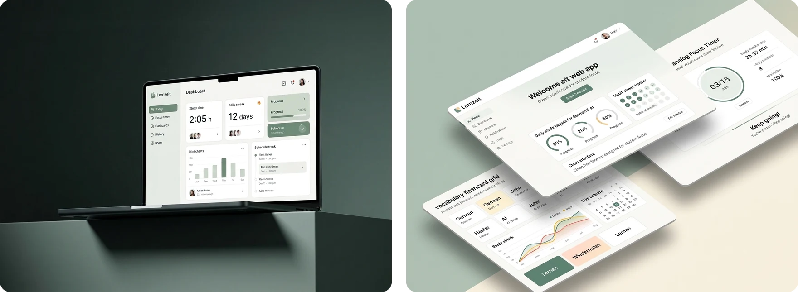
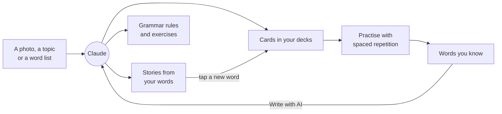
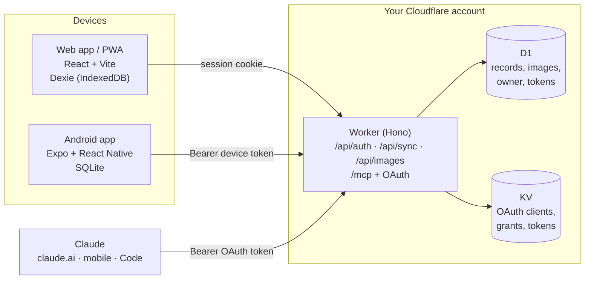
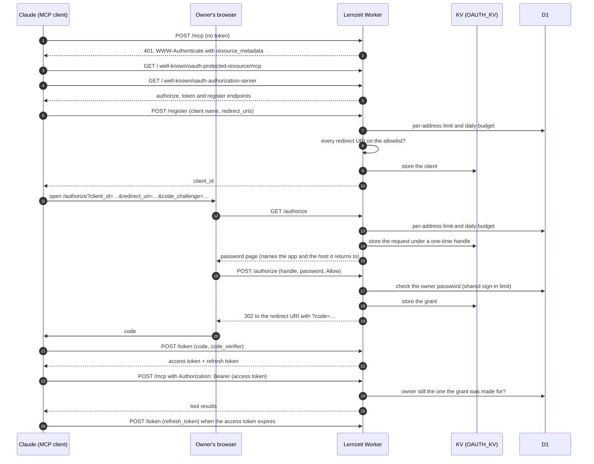

<div align="center">


# Lernzeit

A personal German-learning app for the web and Android. Your library lives in your own Cloudflare account, and Claude can read it and add to it.




</div>

Lernzeit is a study app for one person learning German. It has flashcards with spaced repetition, a focus timer with daily goals, short stories to read with your own words, a grammar course, speaking questions, a Markdown docs reader, a task board and a study history. It runs as a web app you can install as a PWA and as an Android app. Both keep an offline copy and sync through a Cloudflare Worker that you deploy to your own account. The same Worker runs a remote MCP server, so Claude on the web, on your phone or in Claude Code can make cards, stories and grammar lessons straight into your library.

## What's inside

- `src/`: the web app (Vite, React 19, Dexie), installable as a PWA
- `mobile/`: the Android app (Expo SDK 58, React Native, SQLite), in the Lime design
- `worker/`: the cloud, one Cloudflare Worker with D1 and KV that serves sign-in, sync, images and the MCP server
- `packages/core/`: the logic all three share, from FSRS scheduling to sync rules and the actions behind the MCP tools

## Contents

- [The Lernzeit method](#the-lernzeit-method)
- [Learning with Claude](#learning-with-claude)
- [The three parts](#the-three-parts)
- [Features by platform](#features-by-platform)
- [How sync works](#how-sync-works)
- [Claude and MCP](#claude-and-mcp)
- [MCP authentication](#mcp-authentication)
- [Getting started for development](#getting-started-for-development)
- [Deploying](#deploying)
- [Building the Android app](#building-the-android-app)
- [Repo layout](#repo-layout)
- [Privacy and security](#privacy-and-security)
- [The web app in detail](#the-web-app-in-detail)
- [German content](#german-content)
- [Tech stack](#tech-stack)
- [More docs](#more-docs)

## The Lernzeit method

You learn from your own words, and the AI builds everything around them.

| You give | Lernzeit and Claude give you back |
|---|---|
| A picture of words: a textbook page, a menu, a sign | Flashcards for every word, with article, plural, verb forms, an example sentence and audio |
| A word list, or just a topic like *at the doctor* | A full deck on that topic, at your level |
| Your whole word base and your level (Lernzeit sends them for you) | Stories written with the words you know, the grammar you know, and only a few new words |
| Any grammar rule, in plain words: *"Explain the Dativ"* | A lesson with the rule, tables, examples and exercises, each answer explained |

Why it works:

- You read real German from day one. A story you understand almost word for word is easy to read, and reading it is how words stay. Lernzeit shows how much of a story you know, and reading gets easy from about 95%.
- Every new word arrives in context. Each story brings in only a few new words (3 at A1, 5 at A2, 8 at B1), so you meet them in sentences you already understand. Tap one and it becomes a card.
- Grammar comes when you ask for it. Ask about the rule you just met, and practise it on your own nouns and verbs.
- Every card comes back by spaced repetition until you know it, and your study time counts toward a daily goal.

## Learning with Claude

Claude connects to your Lernzeit cloud through the MCP server on your Worker. It reads your decks and saves what it makes into your library, and your devices pick it up on their next sync.



1. **Words in, from anything.** Paste a photo of a textbook page into Claude, give it a list, or name a topic. Claude makes real cards: the article and gender colour, the plural, the verb forms, all six forms of each tense, an example sentence with its English, and an emoji. A word that is already in the deck is skipped.
2. **Practise until it sticks.** Lernzeit asks every card in the directions you pick (picture, English, German or a gap sentence), by typing or by ear, and brings each one back by how well you knew it.
3. **Read with the words you know.** In **Stories → Write with AI** you tick your decks and pick a level and a theme. Lernzeit writes a prompt with every word you know or are learning, and Claude writes the story and saves it with a note on each word you may need help with. In the reader, your words light up by how well you know them, and a new word becomes a card in one tap.
4. **Ask for any grammar rule.** Say *"Explain the Dativ and give me 12 exercises"*. Claude adds a grammar topic with the rule, tables, examples you can listen to, and exercises of four kinds, each with a one-line *why*.
5. **Speak about your life.** Claude adds speaking questions like the ones in an exam, with a suggested answer. You write your own answer once, then answer from memory and compare.

Everything also works without AI. You can type your own cards, stories, questions and grammar, and the German starter gives you 898 words, 107 stories, 44 questions and 27 grammar topics on day one.

### What you can ask Claude

| You say | Claude does |
|---|---|
| *(a photo of a textbook page)* "Make cards for the new words in a deck *Kapitel 3*" | Reads the photo, makes the deck and the cards |
| "Make 15 A1 cards about the kitchen" | Nouns with gender and plural, verbs with their forms, a few phrases |
| *(the prompt from Stories → Write with AI)* | Writes a story from your known words and saves it with word notes |
| "Explain *weil* and *dass* and give me exercises" | A new grammar topic, or more exercises in the one you have |
| "Give me 10 speaking questions about work" | A question set to practise in Questions |
| "Which of my nouns have no plural? Move all food words to a *Food* deck" | Reads your cards and moves them, with their progress kept |
| "Plan my next month for the A2 exam" | Small tasks on the Board, with due dates |
| "Save this explanation as a doc" | A page on Docs to read later |
| "I studied 40 minutes with my teacher today" | Logs the time toward today's goal |

## The three parts



| Part | Stack | Offline store | Talks to the cloud with |
|---|---|---|---|
| Web app | Vite, React 19, Tailwind CSS 4, vite-plugin-pwa | Dexie over IndexedDB | An HttpOnly session cookie |
| Android app | Expo SDK 58, React Native 0.88, Expo Router | expo-sqlite | A device token kept in the Android Keystore (expo-secure-store), sent as `Authorization: Bearer` |
| Cloud | One Cloudflare Worker (Hono), D1, KV | D1 holds the library | It is the cloud |

The Worker also serves the built web app from `dist/`, so one deploy updates the site, the API and the MCP server. Images are stored in D1, so there is no R2 bucket to set up. `packages/core` holds the code that has to behave the same everywhere: the record types, FSRS scheduling, practice queues, answer checking, German helpers, story word matching, the sync rules, the first-sign-in merge and the actions the MCP tools run.

The Android app uses the Lime design: a light grey canvas, a lime accent (`#D4F24A`) with dark text on primary buttons, and a lime launcher icon. [docs/superpowers/specs/2026-11-26-android-redesign-lime.md](docs/superpowers/specs/2026-11-26-android-redesign-lime.md) has the tokens.

## Features by platform

| Feature | Web / PWA | Android |
|---|---|---|
| Today: goals per topic, sessions, word of the day, tasks due | Yes | Yes |
| Focus timer: countdown, Pomodoro, free | Yes | Yes (the end rings as a notification, also with the app closed) |
| Flashcards: decks, editor, quick add, search | Yes | Yes (Cards tab) |
| Practice sessions and practice history | Yes | Yes |
| Stories: reader, word notes, Write with AI prompt | Yes | Yes |
| Grammar: course, exercises, review | Yes | Yes |
| Questions: speaking practice | Yes | Yes |
| Docs: Markdown in folders | Yes | Yes |
| CSV import, backup and restore | Yes | Yes |
| Settings: goals, decks, features, theme, reminders | Yes | Yes |
| History: week calendar, heatmap, streaks, stats | Yes | No |
| Board: Backlog, To do, Doing, Done | Yes | No |
| Settings → Claude: connector address, connected apps | Yes | No |
| German voice | The offline Thorsten voice or a browser voice | Android's German voices |

On the phone, the bottom bar holds Today, Cards, Stories and Timer. Grammar, Questions and Docs open from the menu, and Practice and Settings open as their own screens. Anything you turn off in **Settings → Features** leaves the bars on both platforms, and nothing saved in it is deleted.

## How sync works

Every device reads and writes its own copy of the library, so the app works the same with or without a connection. Each change is also written to an outbox, and sync sends the outbox up and pulls what other devices changed.

- **Offline first.** With no connection you can review, add cards, write and run the timer. The changes wait in the outbox and go up once the device is online again.
- **The newest change wins, per record.** Two devices that edit the same card keep the later edit. A card edited on the laptop and a task added on the phone both survive, because they are different records. If the same card is reviewed on two offline devices, the later review's schedule wins and both review logs are kept.
- **Deletes are kept as tombstones.** A deleted record stays in D1 marked as deleted, so devices that were offline still learn about the delete. A `records` row is never removed (`worker/src/sync.ts`).
- **One account.** There is no sign-up. You create the single owner account with `npm run cloud:owner`, and every device signs in as that owner.
- **Per-device settings stay local.** The voice, speaking speed, theme and reminders belong to each device. Everything else (features, timer lengths, goals) syncs.
- **When it runs.** On start, when the app or tab comes back to the foreground, when the network comes back, 2 seconds after a local change, and every 60 seconds while the app is open (`mobile/src/sync/triggers.ts`, `src/sync/engine.ts`).

The first sign-in on a device that already has data merges it into the cloud and never deletes anything on that device. Duplicates (the same deck or card added on two devices) are folded into one, and practice progress keeps the more-practised side. [docs/cloud.md](docs/cloud.md#the-first-sign-in) has the rules.

**Signing out** syncs first and then clears that device's copy of the library. If some changes could not be uploaded, the app asks **Sign out anyway?**, because they would be lost. On the phone, a sign-out that comes from the cloud (the device was removed in Settings, or the password changed) keeps the local data and outbox until you sign in again or remove them.

**Restore backup** and **Delete all data** apply to every device. D1 Time Travel can put the cloud back to an earlier minute; [docs/cloud.md](docs/cloud.md#undo-a-bad-restore-or-reset-with-time-travel) shows the commands.

## Claude and MCP

The Worker serves a remote [MCP](https://modelcontextprotocol.io) server at `/mcp`, over streamable HTTP. Claude talks to it directly, so nothing runs on your computer and no app has to stay open. What Claude saves goes into D1 and reaches your devices on their next sync; **Settings → Account → Sync now** brings it in at once.

### Tools

From `worker/src/mcp/tools.ts`:

| Group | Tools | What they do |
|---|---|---|
| Decks and cards | `list_decks`, `create_deck`, `list_cards`, `create_cards`, `move_cards`, `delete_cards`, `delete_deck` | Read decks and cards, add cards (tagged `ai`, a German word already in the deck is skipped), move cards with their progress, delete the cards or the deck you name |
| Stories | `create_story` | Add a German story with its translation and notes on the words that need one |
| Docs | `list_docs`, `read_doc`, `create_doc` | Read and save Markdown on the Docs page |
| Grammar | `list_grammar_topics`, `add_grammar` | Look at the grammar topics, add a topic or more exercises |
| Questions | `create_questions` | Add speaking questions with a suggested answer, in a set |
| Study time | `list_topics`, `log_study_time` | Get the topic names, log study done away from the timer |
| Tasks | `create_task` | Add a task to the Board |

The server also offers a `lernzeit://guide` resource that teaches Claude how to write good German cards and stories, and six prompts: `make_cards`, `write_story`, `make_questions`, `make_grammar`, `plan_tasks` and `help`.

What Claude cannot do: it cannot see your review history, your answers or your notes, and it cannot edit existing cards, stories, questions or docs. It does not know which words you know until you paste the **Write with AI** prompt, so you see what it gets. `delete_cards` and `delete_deck` cannot be undone, and the server instructions tell Claude to name the cards or deck and its card count back to you first.

### Connect Claude

The connector address is your Worker's address plus `/mcp`. For this deployment that is:

```text
https://lernzeit.selhamr9.workers.dev/mcp
```

The web app shows it under **Settings → Claude** with a Copy button.

**claude.ai, Claude Desktop and Claude on your phone.** Open **Settings → Connectors**, add a custom connector, and paste the address. Claude opens the Lernzeit password page; type the owner password and choose **Allow**. A connector added on claude.ai also shows up in the phone app.

**Claude Code.**

```bash
claude mcp add --transport http lernzeit https://lernzeit.selhamr9.workers.dev/mcp
```

Then run `/mcp` inside Claude Code and choose **Authenticate**. Your browser opens the same password page.

Earlier versions ran a local MCP server (`npm run mcp:setup` or `lz mcp`). It is gone; [docs/mcp.md](docs/mcp.md#moving-from-the-local-connection) shows how to remove its old entry.

**Disconnecting.** **Settings → Claude → Connected apps → Disconnect** revokes one app. Running `npm run cloud:owner` with a new password disconnects all of them.

## MCP authentication

`/mcp` sits behind OAuth 2.1, provided by [`@cloudflare/workers-oauth-provider`](https://github.com/cloudflare/workers-oauth-provider). The library serves discovery, client registration and the token endpoint, and checks the Bearer token on every `/mcp` request. Lernzeit adds the authorize page, the redirect allowlist, the rate limits and the revocation check. The setup is in `worker/src/index.ts` and `worker/src/oauth.ts`.

### The flow



### Endpoints

| Endpoint | Served by | Job |
|---|---|---|
| `GET /.well-known/oauth-authorization-server` | The OAuth library | Discovery: where to register, authorize and get tokens |
| `GET /.well-known/oauth-protected-resource/mcp` | The OAuth library | Says that `/mcp` is protected and which server issues its tokens |
| `POST /register` | The OAuth library, after Lernzeit's limits | Dynamic client registration |
| `GET /authorize`, `POST /authorize` | Lernzeit (`worker/src/oauth.ts`) | The owner password page |
| `POST /token` | The OAuth library | Swaps a code for an access and refresh token, and refreshes them |
| `/mcp` | Lernzeit (`worker/src/mcp/handler.ts`), behind the library's token check | The MCP server |
| `GET /api/mcp/grants`, `DELETE /api/mcp/grants/:id` | Lernzeit (`worker/src/grants.ts`), app sign-in required | The connected apps in Settings, and Disconnect |

### The password page

`/authorize` asks only for the owner password. It shows the name of the app that asks and the host it will send access back to. The page has no script: its Content Security Policy is `default-src 'none'`, it cannot be framed, and its form may post only to the Worker and to the client's origin. The parsed request stays on the server in KV under a one-time handle bound to the browser by a SameSite cookie, so the form cannot be forged from another site or replayed. A handle works once, whether the password was right or not; a wrong password gets a fresh page with a new handle.

The password is checked by the same code and under the same limit as the app's sign-in (`checkPassword` in `worker/src/auth.ts`). Passwords are hashed with PBKDF2-SHA256 at 100,000 iterations (`worker/src/password.ts`), and an unknown email costs the same hashing time as a wrong password.

### Redirect allowlist

After **Allow**, the Worker sends the browser back to the redirect URI the client registered, but only to hosts listed in `OAUTH_REDIRECT_HOSTS` in [wrangler.jsonc](wrangler.jsonc):

```jsonc
"OAUTH_REDIRECT_HOSTS": "claude.ai,claude.com,localhost,127.0.0.1,[::1]"
```

claude.ai and claude.com cover Claude on the web, desktop and phone. A listed host must match exactly and use `https`. The loopback hosts (`localhost`, `127.0.0.1`, `[::1]`) also accept plain `http` on any port, for Claude Code and other local tools. A redirect URI with a user name or password in it is refused. The check runs at registration and again on the authorize page, so a client stored before a host was removed is refused too (`worker/src/redirects.ts`). To allow another MCP client, add its host and deploy.

### Tokens and their lifetime

`/token` issues an access token and a refresh token. Claude keeps them; the KV store holds only hashes. The lifetimes come from `worker/src/index.ts`:

| Setting | Value | Effect |
|---|---|---|
| `refreshTokenTTL`, `refreshTokenIdleTTL` | 30 days | A grant lasts 30 days, and each refresh moves its end to 30 days after that refresh. Claude stays connected while it is used and is cut off after 30 idle days |
| `clientRegistrationTTL` | 30 days | A registration nobody uses for 30 days expires; token requests renew one in use |
| Access token lifetime | The library's default | Not set in Lernzeit's code |

Every grant carries the time the owner account was written (`ownerCreatedAt`). Running `npm run cloud:owner` writes the owner again, so on the next `/mcp` call each older grant fails the check, is revoked together with its refresh token, and gets a 401 that says *"The Lernzeit password changed. Connect again."* (`mcpApi` in `worker/src/oauth.ts`). Disconnecting one app in Settings revokes its grant; KV can take up to a minute to reach every location.

### Rate limits

| Limit | Value | Where |
|---|---|---|
| Failed password tries, shared by app sign-in and `/authorize` | 10 per address in 15 minutes | `worker/src/auth.ts` |
| Client registrations | 10 per address an hour | `REGISTER_LIMIT` in `worker/src/rateLimit.ts` |
| Openings and submissions of `/authorize` | 30 per address in 15 minutes | `AUTHORIZE_LIMIT` in `worker/src/rateLimit.ts` |
| KV-writing sign-in steps from all addresses together | 200 a day | `SIGN_IN_BUDGET` in `worker/src/rateLimit.ts` |

The limits are counted in D1, in the same transaction as the request is recorded, so parallel requests cannot all slip under them, and they are checked before anything is written to KV. The daily budget exists because Cloudflare's free plan allows 1,000 KV writes a day for everything, token refreshes included; without it, one address within its own limits could spend them all. Past the budget, new sign-ins get *"Too many sign-in attempts today. Try again tomorrow."* and apps already connected keep working.

### Concurrent writes

Each tool call opens its own store, which reads the owner's change counter first. When the call commits, its writes are stored only if the counter has not moved, meaning nothing else (another tool call or a device's push) wrote in the meantime. Otherwise nothing is stored and the call runs again from the start after a short random wait, up to 4 runs in all (`MAX_TOOL_ATTEMPTS` in `worker/src/mcp/tools.ts`, the guard in `worker/src/store.ts`). After that, Claude gets *"Lernzeit was busy; try again."* Tool writes go through the same path as a device's push, so the newest-change-wins rule applies to them too.

### How the app's own sign-in differs

The web and phone apps do not use OAuth. They post the owner's email and password to `POST /api/auth/login`:

| | Web app | Android app |
|---|---|---|
| Sends | Email and password | Email, password and a device name |
| Gets | An HttpOnly, Secure, SameSite=Lax cookie (`lz_session`, 400 days) | A token in the response body, kept in the Android Keystore |
| Sends it back as | The cookie | `Authorization: Bearer <token>` to `/api/sync/*` and `/api/images/*` |

A token is 32 random bytes and D1 stores only its SHA-256 hash, so a leaked database signs nobody in (`worker/src/auth.ts`). The token works until you sign out, remove the device under **Settings → Account**, or change the owner password, which signs every device out. Sign-in and the authorize page share the 10-failures-per-15-minutes limit.

## Getting started for development

### Prerequisites

- Node 24 (the `lz` command and `npm run cloud:owner` run TypeScript directly and need at least 22.18)
- npm, which installs all workspaces (`packages/core`, `worker`, `mobile`) from the root
- For local APK builds only: JDK 17 and the Android SDK ([docs/android.md](docs/android.md))
- For the phone in development: the Expo Go app on an Android phone or emulator

```bash
git clone https://github.com/sel-hamr/Lernzeit.git
cd Lernzeit
npm install
```

### Run the web app

```bash
npm run dev
```

Open http://localhost:5173 and sign in with the owner account. Vite sends `/api` to the Worker named by `LERNZEIT_CLOUD_URL` in [.env](.env), which points at the deployed Worker. So by default local development uses your real cloud data.

### Run the Worker locally

```bash
npm run worker:dev
npm run cloud:owner -- --local
```

`worker:dev` applies the migrations to a local D1 in `.wrangler/` and serves the Worker on http://127.0.0.1:8787. The second command creates a local owner. To point the web app at it, create `.env.local` (not committed) with `LERNZEIT_CLOUD_URL=http://127.0.0.1:8787` and restart `npm run dev`. Delete `.wrangler/` to start the local data empty. [docs/cloud.md](docs/cloud.md#local-development) has the details.

### Run the phone app with Expo Go

```bash
cd mobile
npx expo start
```

Scan the QR code with Expo Go. The app signs in to `https://lernzeit.selhamr9.workers.dev` unless `LERNZEIT_API_URL` is set when Expo starts (`mobile/app.config.ts`). In PowerShell:

```powershell
$env:LERNZEIT_API_URL = "https://your-worker.example.workers.dev"
cd mobile
npx expo start
```

### Environment variables

| Variable | Read by | Default | Job |
|---|---|---|---|
| `LERNZEIT_CLOUD_URL` | Vite (`.env`, overridden by `.env.local` or the shell) | `http://127.0.0.1:8787` when unset | Where the web dev server and `lz` send `/api` |
| `LERNZEIT_API_URL` | `mobile/app.config.ts`, at `expo start` or build time | `https://lernzeit.selhamr9.workers.dev` | Which cloud the phone app signs in to |
| `LERNZEIT_OWNER_EMAIL`, `LERNZEIT_OWNER_PASSWORD` | `npm run cloud:owner -- --local` | Unset (it asks) | A test owner for the local Worker only |

### The full check

```bash
npm run typecheck && npm test && npm run lint && npm run build
```

Windows PowerShell 5.1 has no `&&`: run the four commands one after another, or use PowerShell 7. `npm test` runs the web app's and the shared code's tests (Vitest), the Worker's tests on the real Workers runtime with a local D1, and the phone app's tests (Jest).

### Commands

| Command | What it does |
|---|---|
| `npm run dev` | Starts the web dev server |
| `npm run build` | Type-checks and builds the web app to `dist/`, service worker included |
| `npm run preview` | Serves the production build on http://localhost:4173 |
| `npm start` | Builds if the code changed, then serves and opens the production build (the same as `lz`) |
| `npm run worker:dev` | Runs the Worker locally on http://127.0.0.1:8787 with a local database |
| `npm run cloud:owner` | Sets the email and password of the cloud account (`-- --local` for the local database) |
| `npm test` | Runs every workspace's tests |
| `npm run lint` | Runs ESLint |
| `npm run typecheck` | Runs the TypeScript compiler on every workspace |
| `npm run build:apk -w @lernzeit/mobile` | Builds the signed release APK on this computer |

To start Lernzeit from any folder, run `npm link` once in the project folder. Then `lz` builds when the code changed, serves the production build on http://localhost:5173 and opens it; `lz --build` forces a build, and `lz <script>` runs any npm script, such as `lz test`. `lz` uses the dev server's port on purpose, because the browser keeps data per address, so only one of the two can run at a time. `npm unlink -g lernzeit` removes it.

## Deploying

The Worker in [wrangler.jsonc](wrangler.jsonc) serves the web app from `dist/` and answers `/api/*`, `/mcp` and the OAuth routes (`/authorize`, `/token`, `/register`, `/.well-known/*`). Its bindings are `DB` (the D1 database `lernzeit`), `OAUTH_KV` (KV for OAuth clients, grants and tokens) and `ASSETS` (the static files). The free plan is enough.

Cloudflare Workers Builds deploys `main` automatically. To deploy by hand, run `npm run build` and then `npx wrangler deploy`.

When `worker/migrations/` has a new file, apply it before the code that needs it goes live:

```bash
npx wrangler d1 migrations apply lernzeit --remote
```

### First-time setup

```bash
npx wrangler login
npx wrangler d1 create lernzeit
npx wrangler kv namespace create OAUTH_KV
```

Put the printed `database_id` under `d1_databases` and the KV `id` under `kv_namespaces` in [wrangler.jsonc](wrangler.jsonc). Then apply the migrations, deploy, and create the owner:

```bash
npx wrangler d1 migrations apply lernzeit --remote
npm run build && npx wrangler deploy
npm run cloud:owner
```

`npm run cloud:owner` asks for the owner's email and a password of at least 10 characters, typed twice and hidden. It hashes the password on your computer and writes only the hash to D1 through wrangler (`scripts/cloud-owner.ts`). Run it again to change the password; that keeps all data, signs every device out and disconnects every MCP client. Put the address `wrangler deploy` prints in `.env` as `LERNZEIT_CLOUD_URL`. `/api/health` answers `{"ok":true}` when the Worker is up.

A static-only host (Netlify, Vercel, GitHub Pages) is not enough, because the app needs the Worker's `/api`. To install the web app on a phone, open the address and choose **Add to Home screen**.

## Building the Android app

The app is in `mobile/`. `mobile/android` is generated by `expo prebuild` and not committed. [docs/android.md](docs/android.md) has every step.

### On EAS (recommended)

```powershell
cd mobile
npx eas-cli build -p android --profile preview
```

Expo's cloud builds the APK, and it appears on expo.dev with an install link and a QR code. No Java or Android SDK is needed on your computer. Sign in once with `npx eas-cli login`. Both profiles in [mobile/eas.json](mobile/eas.json), `preview` and `production`, build an APK and use `credentialsSource: local`, so EAS signs with the same keystore as a local build, read through `mobile/credentials.json`.

### On your computer

```powershell
npm run build:apk -w @lernzeit/mobile
```

The script loads the signing variables, runs `expo prebuild --platform android --clean` and `gradlew assembleRelease`, and copies the APK to `mobile/dist/lernzeit-<version>.apk`. Without signing variables it stops; it never falls back to the debug key.

On Windows the native build can fail with `ninja: error: mkdir(...)` once a path passes 260 characters. Build from a short drive letter instead:

```powershell
subst L: C:\path\to\Lernzeit
cd L:\mobile
npm run build:apk
subst L: /D
```

If a build already failed, delete the `android/.cxx` folders of `react-native-worklets` and `react-native-reanimated` under `mobile/node_modules` first.

### Signing

The release keystore lives outside the repo, in `%USERPROFILE%\.lernzeit-android\`, next to a `keystore.env` that holds its path, alias and passwords. Back both files up in a password manager or on an encrypted drive. Android installs an update only if it is signed with the same key, so a lost key means uninstalling the app and losing its local data (the cloud copy stays).

The Android `versionCode` is derived from `version` in `mobile/package.json`, so raise the version before each release you install over an older one. Install with `adb install -r mobile/dist/lernzeit-<version>.apk`, or copy the APK to the phone and open it.

## Repo layout

```text
.
├── src/                The web app
│   ├── app/            Shell, routing, feature plugins, welcome and tour, timer and reminder engines
│   ├── components/     Shared UI
│   ├── data/           Database actions and React hooks
│   ├── db/             Dexie schema
│   ├── features/       One folder per page: today, timer, flashcards, grammar, stories,
│   │                   questions, docs, history, board, settings, login
│   ├── languages/      The German pack (A1, A2, B1)
│   ├── lib/            Pure logic: speech, the Thorsten voice worker, image resizing
│   └── sync/           Outbox, sync engine, account, first-sign-in merge
├── packages/core/      Shared by all three: types, FSRS, practice, grammar, stories,
│                       sync rules, the merge, and the MCP tool actions
├── worker/             The Cloudflare Worker (an npm workspace)
│   ├── src/            Sign-in, sync, images, OAuth, rate limits, redirect allowlist
│   ├── src/mcp/        The MCP server: tools, prompts, the guide
│   ├── src/pages/      The authorize page
│   └── migrations/     D1 migrations
├── mobile/             The Android app (Expo, an npm workspace)
│   ├── app/            Expo Router screens: tabs, practice, card, story, grammar, docs, settings
│   ├── src/            Screens' parts, the SQLite store, sync, account, theme
│   ├── plugins/        Release signing for prebuild
│   └── scripts/        build-apk
├── docs/               How each part works, plus design specs in docs/superpowers/specs
├── public/             Icons and the German starter the welcome downloads
├── scripts/            cloud-owner and make-starter
├── bin/                The lz command
└── wrangler.jsonc      The Worker's bindings, routes and redirect allowlist
```

Tests sit next to the code they test, as `*.test.ts`.

## Privacy and security

- Lernzeit has one user, the owner. There is no sign-up page, and the library lives in the D1 database of the owner's own Cloudflare account.
- Nothing is sent to an AI unless you paste it or ask Claude to read it. Claude reaches the library only through `/mcp`, and only after the owner types the password on the authorize page.
- D1 stores hashes, never plain passwords or tokens: PBKDF2 for the password, SHA-256 for device tokens. The OAuth library keeps only token hashes in KV.
- No secrets are in the repo. `mobile/credentials.json`, keystores (`*.jks`, `*.keystore`, `*.p12`) and `.env.local` are gitignored, and the signing key lives outside the repo. The Worker address in `.env` is public and not a secret.
- The phone keeps its device token in the Android Keystore, never in the SQLite file or in logs.

## The web app in detail

| Page | What it does |
|---|---|
| Today | Progress per topic with time left, today's sessions, flashcard practice time, word of the day, tasks due today |
| Focus timer | Countdown, Pomodoro and free mode. Keeps running through a refresh, a closed tab or a sleeping phone |
| Flashcards | Your decks, each practised whole in the directions you pick, practice history, word, sentence and cloze cards, typing and listening modes |
| Grammar | A course from A1 to B1: 27 topics with the rule, examples and 384 explained exercises of four kinds, a path with progress, and spaced review |
| Stories | Short German stories read with your decks: words light up by how well you know them, and any word can become a card |
| Questions | Speaking questions: write your own answer once, then answer from memory and compare |
| Docs | Markdown in nested folders, read like a README. Pinned and recent docs, tags, read status, search |
| History | Week calendar, 16-week heatmap, streaks, hours per topic and flashcard stats |
| Board | Backlog, To do, Doing and Done, with drag and drop on desktop and touch |
| Settings | Goals per weekday, decks, starter content, voice, the Claude connection, features, themes, reminders, the tour, backup and restore, account and sign out |

Press <kbd>/</kbd> anywhere to search cards, tasks and docs.

<details>
<summary><b>Focus timer</b></summary>
<br />

- Three modes: countdown (defaults to the time left today), Pomodoro (focus and break lengths are in Settings) and free.
- The timer is stored as timestamps, so it survives a refresh, a closed tab or a sleeping phone. It syncs, so a timer started on the web shows on the phone, and only the device that started it rings.
- Plays a bell at the end and asks *"What did you learn?"*
- A session that runs past midnight is split between the two days.

</details>

<details>
<summary><b>Flashcards</b></summary>
<br />

- Word, sentence and cloze cards (`Der Hund {{spielt}} im Garten.`), coloured by gender: <b>der</b> blue, <b>die</b> red, <b>das</b> green.
- Deck tabs fit on one line; the rest sit behind a **more** button that opens a deck search (case, accents and ß don't matter). There are no due counts.
- **Practise deck** asks which directions to take: Image → German, English → German, German → English or Cloze. The session asks every card in those directions, and your rating says when it comes back: **Again** 3 cards later, **Hard** 8, **Good** 15, and **Easy** not again. The session ends once every card is rated **Easy**. Ratings are still kept with FSRS ([ts-fsrs](https://github.com/open-spaced-repetition/ts-fsrs)).
- **Practice history** saves every session after each rating, so one you leave half-way counts too: start and end, time on the cards (at most two minutes a card), reviews and how many were right, and the time per deck.
- **Select** lets you tick cards across decks and practise only those.
- After a card, the next one is always a different word. A word repeats only when it is the last one left.
- Typing mode accepts small slips (`ue` for `ü`, a missing umlaut, lowercase, a missing article), then shows the exact spelling with the wrong letters marked. Listening mode plays the German and you type what you hear, at 0.6×, 0.8×, 1× or 1.2×.
- The Thorsten voice is a natural German voice that runs on your device. It downloads once (63 MB) and then needs no internet, key or account. Voice by Thorsten Müller ([Thorsten-Voice](https://github.com/thorstenMueller/Thorsten-Voice), public domain). [docs/voice.md](docs/voice.md) explains it.
- Images can be uploaded, pasted with <kbd>Ctrl</kbd>+<kbd>V</kbd> or dropped, and are resized to 600 px wide WebP. A card can use an emoji instead.
- The **+** button quick-adds an English and German pair, tagged `incomplete`.

</details>

<details>
<summary><b>Grammar</b></summary>
<br />

- 27 topics from A1 to B1 in seven sections, each with the rule and its tables, examples you can listen to, and 12 to 16 exercises: 384 in all.
- Four kinds of exercise: fill the gap, find the mistake, put the words in order, and write the sentence.
- Every answer is explained, and **Ask Claude why** opens a Claude chat with the exercise, your answer and the rule.
- Topics are ordered by level with a ring that fills as you learn them. A topic is mastered at 80% of its exercises.
- A wrong answer comes back in the same round and again minutes later; right answers come back after 1, 3, 7, 16, 35 and 75 days.
- Topics that fit your cards also drill your own words: your nouns' genders and plurals, and your verbs in Präsens, Präteritum and Perfekt from each card's conjugation.
- `ue` for `ü` and lowercase are accepted, but a missing umlaut is wrong. [docs/grammar.md](docs/grammar.md) has the details.

</details>

<details>
<summary><b>Stories</b></summary>
<br />

- Words from your decks are highlighted by how well you know them: yellow for new, green for learning, a thin underline once known. Nouns take their gender colour.
- Words are found in their forms too: plurals, verb endings, past tenses, adjective endings, *im* for *in*, *ihn* for *er*.
- Tap a word to see its card. A word that is not in a deck can be added in one step, with the story's sentence as its example.
- A bar shows how much of the story you know. Reading is easy from about 95% known.
- **Write with AI** builds a prompt from the decks you tick, at your level and theme, with 45 theme ideas in eight groups. [docs/stories.md](docs/stories.md) explains how words are matched.

</details>

<details>
<summary><b>Questions, Docs, History and Board</b></summary>
<br />

- **Questions** have the German, the English, your own answer and a suggested answer, grouped in sets. You type your answer from memory and compare; every answer you type is kept, so you can see it improve. There is no grading. [docs/questions.md](docs/questions.md)
- **Docs** read like a GitHub README: tables, task lists, highlighted code with a Copy button, images and a table of contents. A doc reopens where you stopped. [docs/docs.md](docs/docs.md)
- **History** has a week calendar (zoom with <kbd>Ctrl</kbd> + wheel), a day view, a 16-week heatmap, streaks, hours per topic and flashcard stats. A changed goal applies from that day on, so past days keep their goal.
- **Board** has four columns with drag and drop on desktop and touch, and filters by topic, priority or **Today**.

</details>

<details>
<summary><b>Keyboard shortcuts</b></summary>
<br />

| Key | Where | Action |
|---|---|---|
| <kbd>/</kbd> | Anywhere | Search cards, tasks and docs |
| <kbd>Space</kbd> | Focus timer | Start or pause |
| <kbd>Space</kbd> | Review | Show the answer, then press again to rate it Good |
| <kbd>1</kbd> to <kbd>4</kbd> | Review | Rate Again, Hard, Good or Easy |
| <kbd>Z</kbd> | Review | Undo the last rating |
| <kbd>Esc</kbd> | Review | Back to the library |
| <kbd>1</kbd> to <kbd>4</kbd> | Grammar practice | Pick a choice; der, die, das are always 1, 2, 3 |
| <kbd>Enter</kbd> | Grammar and Questions practice | Check the answer, then go to the next question |
| <kbd>Backspace</kbd> | Grammar practice | Take back the last word when putting words in order |
| <kbd>Shift</kbd> + <kbd>Enter</kbd> | Questions practice | New line in your answer |
| <kbd>Ctrl</kbd> + wheel | History week | Zoom the calendar |

</details>

Reminders and end-of-timer notifications in the web app use the browser's Notification API. They fire only while the app is open or running in the background as an installed PWA.

## German content

You can start with ready-made German, start empty and let Claude build your decks, or both. Nothing is added until you ask for it.

The first time you open Lernzeit with no data, a short welcome asks what you want to learn (German, AI or your own topic) and how much time a day. Picking German adds 898 words and phrases in 52 decks, 107 short stories, 44 speaking questions and 27 grammar topics, all as new cards with no history. It is downloaded only then, from [public/starter/german.json](public/starter/german.json). **Settings → Starter content** adds the A1, A2 or B1 level of the pack in `src/languages/de/`; [docs/languages.md](docs/languages.md) lists what each level holds.

To bring your own cards, ask Claude, import a CSV (`english, german, gender, plural, example_de, example_en, tags, deck`, plus optional `emoji`, `verb_forms`, `present`, `past` and `perfect`), import a card pack (JSON with `"format": "lernzeit-cards"`), or type them in the editor. Both file kinds import in **Settings → Decks → Import**.

To refresh the starter from a newer backup, run the command below, then update `GERMAN_SUMMARY` in [src/data/starter.ts](src/data/starter.ts) if the counts changed (a test checks they match):

```bash
node scripts/make-starter.ts path/to/lernzeit-backup.json
```

## Tech stack

| Area | Tools |
|---|---|
| Web UI | React 19, TypeScript 6, React Router, Tailwind CSS 4, lucide-react, Geist |
| Web build | Vite 8, vite-plugin-pwa |
| Web data | Dexie (IndexedDB), dexie-react-hooks, Papa Parse |
| Phone | Expo SDK 58, React Native 0.88, Expo Router, expo-sqlite, expo-secure-store, expo-notifications, expo-speech, Reanimated, lucide-react-native |
| Cloud | Cloudflare Workers, Hono, D1, KV |
| AI connection | `@modelcontextprotocol/server`, zod, `@cloudflare/workers-oauth-provider` |
| Learning | ts-fsrs |
| Voice (web) | Piper through @mintplex-labs/piper-tts-web and onnxruntime-web, the Thorsten voice |
| Docs | react-markdown, remark-gfm, rehype-highlight |
| Interaction | dnd-kit, Recharts, driver.js |
| Quality | Vitest, `@cloudflare/vitest-plugin`, Jest with jest-expo, ESLint, fake-indexeddb |

## More docs

- [SPEC.md](SPEC.md): the full product spec
- [docs/cloud.md](docs/cloud.md): cloud sync, the first-sign-in merge, Time Travel, local development and deploy
- [docs/mcp.md](docs/mcp.md): connecting Claude, the tools, disconnecting, the redirect allowlist
- [docs/android.md](docs/android.md): building, signing and installing the Android app
- [docs/grammar.md](docs/grammar.md), [docs/stories.md](docs/stories.md), [docs/questions.md](docs/questions.md), [docs/docs.md](docs/docs.md), [docs/languages.md](docs/languages.md), [docs/voice.md](docs/voice.md): how each part of the app works
- [docs/journal.md](docs/journal.md) and [docs/speaking.md](docs/speaking.md): two planned features
- [docs/superpowers/specs/2026-11-21-mobile-app-and-cloud-design.md](docs/superpowers/specs/2026-11-21-mobile-app-and-cloud-design.md): the design of the phone app and the cloud
- [design/](design/): the original design mockups
