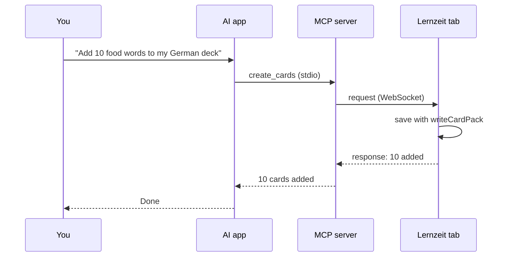

# MCP bridge

Lets an AI app (Claude Code, Claude Desktop, Cursor) add cards, decks, stories, practice questions, tasks and study time to Lernzeit.

## Why a bridge

Lernzeit keeps all data in IndexedDB, inside the browser. An MCP server is a separate Node program, and a browser does not let outside programs open its database.

So the server never touches the data. It passes each request to the open Lernzeit tab, and the app saves it with the code it already has. This means:

- No new database and no data migration.
- AI-made cards get their FSRS reviews, gender and tags the same way as cards you add by hand.
- New items show up on screen right away, because every view uses live queries.
- Offline mode and the phone app stay the same.

## How it works

| Part | Runs in | Job |
|---|---|---|
| AI app | Claude Code, Claude Desktop… | Picks a tool and calls it |
| MCP server ([mcp/](../mcp)) | Node, started by the AI app | Offers the tools and waits for Lernzeit on a WebSocket |
| Bridge ([src/bridge/](../src/bridge)) | The Lernzeit tab | Connects to the server, runs each request, sends back the result |



The app opens the connection, not the server. The server listens on `127.0.0.1:47821`. When Lernzeit is open and the switch is on, the app connects. If the server is not running, the app tries again after 5 seconds, then less often, up to every 30 seconds.

## Choosing a browser

Each browser, and each Chrome profile, has its own data. You choose which ones can connect.

### Settings → AI connection

- **Connect to AI:** off by default. Turn it on only where you want it.
- **Browser name:** for example `Chrome Personal`. Empty means the browser type (Chrome, Edge, Firefox). A website cannot read the Chrome profile name, so you type it.
- **Port:** `47821` unless you changed it on the server.
- **Token:** the same secret as `LERNZEIT_TOKEN` in the server config (see [Safety](#safety)). **Generate** makes a new one, and the eye button shows it.
- **Set up your AI app:** **Copy for Claude Desktop** copies the `"lernzeit"` entry for `claude_desktop_config.json`, and **Copy for Claude Code** copies the `claude mcp add` command. Both include the token, and the port and this page's address when they differ from the defaults. The dev server knows the path to `mcp/src/index.ts`; a build shows a placeholder instead.

While the switch is on, the sidebar shows an **AI** row with the status, and on phones a dot on the Settings icon. Both link to this card.

The status chip shows one of:

| Status | Meaning |
|---|---|
| Needs a token | The switch is on, but the token is empty |
| Connected | The AI can use this browser |
| Waiting for the AI app | The server is not running; the tab keeps trying |
| Connected in another tab | Another Lernzeit tab in this browser holds the connection |
| Wrong token | The token does not match the server's |
| Name in use | Another browser connected with the same name |
| Version mismatch | The app and the server speak different protocol versions |

After **Wrong token**, **Name in use** or **Version mismatch** the tab stops trying until you change a setting.

These values are saved under their own `kv` key, `bridge`, not inside `Settings`. A backup never contains them, and restoring a backup keeps them.

### How the server picks

| Connected | You named a browser? | Result |
|---|---|---|
| none | – | Error: "Open Lernzeit and turn on Connect to AI." |
| one | no | Uses it |
| two or more | no | Error with the list of names; the AI asks you which one |
| any | yes | Uses that one. An unknown name gives an error with the list |

Names are matched without caring about upper or lower case.

### Many tabs in one browser

Only one tab connects. The tabs share a Web Lock (`navigator.locks`), and when that tab closes, another one takes over. So a request never runs twice.

## Tools

Every tool except `list_browsers` takes an optional `browser` (its name).

| Tool | Input | Returns | Uses |
|---|---|---|---|
| `list_browsers` | – | name, kind, connected since | – |
| `list_topics` | – | id, name | `db.topics` |
| `list_decks` | – | id, name, topic, card count | `db.decks`, `db.cards` |
| `create_deck` | `name`, `topic`? | the deck, and whether it was created | `createDeck` |
| `create_cards` | `deck` (name or id), `cards[]` | added count, skipped words | `writeCardPack` |
| `create_story` | `title`, `text`, `translation`?, `level`?, `tags`?, `topic`? | the story, and whether it was created | `saveStory` |
| `create_questions` | `set`, `questions[]` | the set's name, added count, skipped questions | `saveQuestion` |
| `list_grammar_topics` | – | id, title, English, level, section, exercise count | `db.grammarTopics` |
| `add_grammar` | `topic` (title or id), `exercises[]`?, `examples[]`?, and for a new topic `rule`?, `english`?, `group`?, `level`?, `summary`? | the topic, whether it was created, added count, skipped exercises | `saveTopic` |
| `create_task` | `title`, `description`?, `priority`?, `status`?, `dueDate`?, `topic`? | the new task | `createTask` |
| `log_study_time` | `topic`, `minutes`, `start`?, `note`? | the saved session | `logManualSession` |

- A `topic` is given by name. The bridge looks up its id and returns `topic_not_found`, with the real names, if there is no match.
- `create_deck` returns the existing deck when the name is taken.
- `create_task` defaults to priority `medium` and status `todo`.
- `log_study_time` takes `start` in local time (`2026-10-15T08:30`). Without it, the session ends now. Time in the future is refused, and a session over midnight is split between the two days.

### `create_cards`

- Each card has `english` and `german`, plus any of `type` (`word`, `sentence`, `cloze`), `gender`, `plural`, `verbForms`, `conjugation` (the present, past and perfect as six forms each, for grammar practice), `partOfSpeech`, `exampleDe`, `exampleEn`, `tags`, `emoji` and `imageQuery`.
- A leading article moves into `gender` ("der Hund" becomes `Hund`, `der`). Text with `{{…}}` becomes a cloze card.
- Every card gets the tag `ai`, so you can find and check them in the Library.
- A card whose German text is already in the deck (ignoring case) is skipped and listed in `skipped`.
- Up to 100 cards per call.
- No image uploads. `emoji` and `imageQuery` work, and only nouns are practised from the picture.

### `create_story`

- `text` is German, with an empty line between paragraphs. A `translation` with the same number of paragraphs shows under each one; otherwise it shows after the story.
- `level` is A1, A2, B1, B2, C1 or C2. Reading time counts toward `topic`, or toward the topic of the first deck that has one (German, out of the box).
- Every story gets the tag `ai`. A story whose text is already saved is returned with `created: false` instead of being added twice.
- Text and translation can each have up to 20,000 characters, and the title up to 120.

### `create_questions`

- Each question has `question` (German), plus any of `english`, `suggested` (a model answer in German), `words` (up to 12 useful words, shown as hints in practice), `level` and `tags`.
- There is no field for the user's own answer: they write it in the app, about their life.
- `set` names the group, up to 60 characters. A set that exists already, in any case, gets the new questions; another name starts a new set.
- Every question gets the tag `ai`. A question already in the set (ignoring case) is skipped and listed in `skipped`.
- Up to 50 questions per call, and up to 500 characters for each question and answer.

### `add_grammar`

- A topic is found by id, or by title ignoring case. A title that matches none starts a new topic, which needs a `rule` or some exercises; its section defaults to *My topics*.
- An existing topic keeps its title, section and rule. Exercises and examples are added at the end; a rule is filled in only when the topic has none.
- Each exercise is `text`, `en`? and `why`?, in the formats of [docs/grammar.md](grammar.md#writing-a-topic): choices `{{dem|den|der}}`, a typed gap `{{fährst}}`, a mistake `{{den>dem}}`, word order `~ …`, or `prompt => answer`. A text the app cannot use is refused with its number and the reason, and nothing is saved.
- An exercise the topic already has (ignoring case) is skipped and listed in `skipped`. The same goes for examples, silently.
- Up to 50 exercises and 20 examples per call, up to 300 characters per field, and 8,000 for the rule.
- The AI only sees topic names and exercise counts, never your answers or scores.

## Guide and prompts

Besides the tools, the server offers:

- **Resource `lernzeit://guide`:** everything the AI needs to know, in one page. It covers what Lernzeit is, each tool, how to write good German cards (article in `gender`, plural with its article, cloze gaps) and what each error means. In Claude Desktop, attach it from the **+** menu.
- **Prompts:** ready-made requests that already include the guide. In Claude Desktop, pick them from the **+** menu.

| Prompt | Asks for | Arguments |
|---|---|---|
| `make_cards` | A set of German cards on a theme | `theme`, `count`? (10), `level`? (A2), `deck`? |
| `write_story` | A short German story with its translation, then useful words to add as cards | `theme`, `level`? (A2), `words`? (150) |
| `make_questions` | German questions on a theme, each with its English and a suggested answer | `theme`, `count`? (10), `level`? (A2) |
| `make_grammar` | Grammar exercises of every kind, each with its English and a why, added to the topic that fits or a new one | `topic`, `count`? (12), `level`? (A2) |
| `plan_tasks` | A goal broken into board tasks, shown before they are added | `goal`, `until`?, `topic`? |
| `help` | What the AI can do, plus a connection check | – |

The guide lives in [mcp/src/guide.ts](../mcp/src/guide.ts), and a test checks that it mentions every tool.

## Messages

Server and app send JSON text over the WebSocket. The types and their parsers live in [src/bridge/protocol.ts](../src/bridge/protocol.ts), and both sides import that file.

**1. Hello.** The app sends this right after it connects:

```json
{ "type": "hello", "version": 1, "token": "…", "name": "Chrome Personal", "kind": "Chrome" }
```

**2. Welcome or reject.** The server answers `{ "type": "welcome" }`, or `{ "type": "rejected", "reason": "wrong_token" }` and closes the connection. The reasons are `wrong_token`, `unsupported_version` and `invalid_hello`.

**3. Request.** The server sends one per tool call:

```json
{ "type": "request", "id": "…", "action": "create_cards", "params": { "deck": "German", "cards": [] } }
```

**4. Response.** The app answers with the same `id`:

```json
{ "type": "response", "id": "…", "ok": true, "result": { "deck": "German", "added": 10, "skipped": [] } }
```

```json
{ "type": "response", "id": "…", "ok": false, "error": { "code": "deck_not_found", "message": "No deck named \"German\". Decks: My Words, Food." } }
```

If no answer arrives within 15 seconds, the tool fails with `timeout`. When a second browser connects with the same name, the server closes the first one with code `4000`.

Error codes: `no_browser`, `pick_browser`, `unknown_browser`, `disconnected`, `timeout`, `port_in_use`, `deck_not_found`, `topic_not_found`, `invalid_input`, `internal`. Messages are written for the AI to read and act on.

## Limits

- Lernzeit must be open in a browser with the switch on.
- The AI app and the browser must be on the same computer.
- Data lands in one browser only. To get it onto your phone, use backup and restore. Real sync needs a cloud database, which is a separate project.
- Only one AI app can use the bridge at a time. A second server cannot take the port; its tools return `port_in_use`, and it keeps trying in case the port frees up.
- When Lernzeit runs from a hosted `https` address, Chrome may ask to allow access to local devices. Click Allow.
- The AI can list decks, topics and grammar topics, but it cannot read your cards, answers, scores, history or notes.

## Safety

- The server listens on `127.0.0.1` only, never on your network.
- The switch is off in every browser until you turn it on.
- **Token:** a secret you put in the server config and paste in Settings. The server drops any connection with the wrong token, comparing in constant time.
- **Origin check:** any website can try to open a WebSocket to localhost, so the server only accepts pages from the local dev and preview addresses and from `LERNZEIT_ORIGINS`.
- There are no delete or edit tools. The AI can only add things and list decks, topics and grammar topics.
- The server writes logs to stderr only, because stdout carries the MCP messages.

## Setup

It needs Node 22.18 or newer, which runs the TypeScript directly.

1. Install, from the repo root (it also installs `mcp/`, an npm workspace):

   ```sh
   npm install
   ```

2. Add the server to Claude Code and Claude Desktop:

   ```sh
   npm run mcp:setup
   ```

   It runs `claude mcp add` for Claude Code, adds the `"lernzeit"` entry to Claude Desktop's `claude_desktop_config.json` next to your other servers, and prints the token both of them use. An app that is not installed is skipped.

3. In Lernzeit, open **Settings → AI connection**, turn the switch on, type a browser name and paste the token.
4. Restart Claude Desktop, or start a new Claude Code session. The status turns to **Connected** once the server is running.
5. Ask the AI: "Which Lernzeit browsers are connected?"

### `npm run mcp:setup`

Running it again is safe: it replaces the old entry, and keeps the token, port and origins from Claude Desktop's config unless you change them.

| Option | What it does |
|---|---|
| `--code`, `--desktop` | Set up only that app |
| `--token <token>` | Use this token, such as the one already in Settings. Default: the one set before, or a new one |
| `--port <port>` | WebSocket port, see `LERNZEIT_PORT` below |
| `--origins <urls>` | Extra page addresses, see `LERNZEIT_ORIGINS` below |
| `--scope <scope>` | Claude Code scope: `user` (the default, so it works from any folder), `local` or `project` |
| `--print` | Show what it would add, and change nothing |

Options go after `--`, such as `npm run mcp:setup -- --desktop --token <token>`. It finds Claude Desktop's config in `%APPDATA%\Claude` on Windows (and in the Microsoft Store app's folder), `~/Library/Application Support/Claude` on macOS and `~/.config/Claude` on Linux. If that file is not valid JSON, it stops and changes nothing.

### By hand

**Copy for Claude Desktop** and **Copy for Claude Code** in Settings give you the same lines with your token and path filled in.

Claude Code:

```sh
claude mcp add lernzeit -e LERNZEIT_TOKEN=<token> -- node <repo>/mcp/src/index.ts
```

Claude Desktop (`claude_desktop_config.json`):

```json
{
  "mcpServers": {
    "lernzeit": {
      "command": "node",
      "args": ["<repo>/mcp/src/index.ts"],
      "env": { "LERNZEIT_TOKEN": "<token>" }
    }
  }
}
```

### Server settings

| Variable | Default | What it does |
|---|---|---|
| `LERNZEIT_TOKEN` | none (required) | Shared secret |
| `LERNZEIT_PORT` | `47821` | WebSocket port. Change it in Settings too |
| `LERNZEIT_ORIGINS` | none | Extra page addresses allowed to connect, comma-separated, e.g. your hosted Lernzeit. `localhost` and `127.0.0.1` on ports 5173 and 4173 are always allowed |

## Code

```
mcp/
  src/index.ts          starts the hub and serves the MCP server on stdio
  src/hub.ts            WebSocket server: origin and token checks, picking a browser, requests and answers
  src/tools.ts          the seven tools, their zod inputs and descriptions
  src/guide.ts          the guide resource
  src/prompts.ts        the guide resource and the prompts
  src/config.ts         reads the environment variables
  src/*.test.ts         node:test
src/bridge/
  protocol.ts           message and action types, shared with mcp/
  actions.ts            one handler per action, built on src/data
  connection.ts         WebSocket client: hello, retries, the tab lock
  config.ts             the per-browser settings
  setup.ts              token and the copy-paste setup for Claude Desktop and Claude Code
  status.ts             connection status for the Settings page
  bridge.test.ts        end to end: the real hub, the connection and the actions on a fake database
src/app/engines.tsx     BridgeEngine keeps the tab connected while the switch is on
```

`npm test` and `npm run typecheck` at the root cover both the app and `mcp/`. `npm run lint` lints both.
