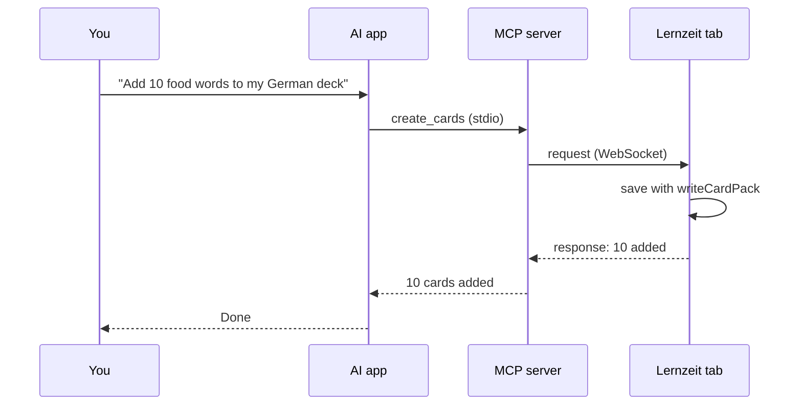

# MCP bridge

Lets an AI app (Claude Desktop, Claude Code, Cursor) add cards, decks, tasks and study time to Lernzeit.

**Status:** planned, not built yet · October 2026

## Why a bridge

Lernzeit keeps all data in IndexedDB, inside the browser. An MCP server is a separate Node program, and a browser does not let outside programs open its database.

So the server never touches the data. It passes each request to the open Lernzeit tab, and the app saves it with the code it already has. This means:

- No new database and no data migration.
- AI-made cards get their FSRS reviews, gender and tags the same way as cards you add by hand.
- New items show up on screen right away, because every view uses live queries.
- Offline mode and the phone app stay the same.

## How it works

| Part | Runs in | Job |
|---|---|---|
| AI app | Claude Desktop, Claude Code… | Picks a tool and calls it |
| MCP server (`mcp/`) | Node, started by the AI app | Offers the tools and waits for Lernzeit on a WebSocket |
| Bridge (`src/bridge/`) | The Lernzeit tab | Connects to the server, runs each request, sends back the result |



The app opens the connection, not the server. The server listens on `127.0.0.1:47821`. When Lernzeit is open and the switch is on, the app connects. If the server is not running yet, the app tries again every 5 seconds.

## Choosing a browser

Each browser, and each Chrome profile, has its own data. You choose which ones can connect.

### Settings → AI connection

- **Connect to AI:** off by default. Turn it on only where you want it.
- **Browser name:** for example `Chrome Personal`. The app fills in the browser type (Chrome, Edge, Firefox) and you add the rest. A website cannot read the Chrome profile name, so you type it.
- **Token:** the same secret as in the server config (see [Safety](#safety)).
- **Port:** `47821` unless you changed it on the server.
- **Status:** Connected · Waiting for the AI app · Wrong token.

These values are saved under their own `kv` key, `bridge`, not inside `Settings`. That way a backup never copies them to another browser.

### How the server picks

| Connected | You named a browser? | Result |
|---|---|---|
| none | – | Error: "Open Lernzeit and turn on Connect to AI in Settings." |
| one | no | Uses it |
| two or more | no | Error with the list of names; the AI asks you which one |
| any | yes | Uses that one. An unknown name gives an error with the list |

Names are matched without caring about upper or lower case.

### Many tabs in one browser

Only one tab connects. The tabs share a lock (`navigator.locks`), and when that tab closes, another one takes over. So a request never runs twice.

## Tools

Every tool except `list_browsers` takes an optional `browser` (its name).

| Tool | Input | Returns | Uses |
|---|---|---|---|
| `list_browsers` | – | name, kind, connected since | – |
| `list_topics` | – | id, name | `db.topics` |
| `list_decks` | – | id, name, topic, card count | `db.decks`, `db.cards` |
| `create_deck` | `name`, `topic`? | the new deck | `createDeck` |
| `create_cards` | `deck` (name or id), `cards[]` | added, skipped | `writeCardPack` |
| `create_task` | `title`, `description`?, `priority`?, `status`?, `dueDate`?, `topic`? | the new task | `createTask` |
| `log_study_time` | `topic`, `minutes`, `start`?, `note`? | the saved session | `logManualSession` |

A `topic` is given by name. The bridge looks up its id and returns `topic_not_found` if there is no match.

### `create_cards`

- Each card has `english` and `german`, plus any of `type` (`word`, `sentence`, `cloze`), `gender`, `plural`, `verbForms`, `exampleDe`, `exampleEn`, `tags`, `emoji` and `imageQuery`. These are the `CardPackCard` fields in [src/data/io.ts](../src/data/io.ts).
- The bridge builds a `lernzeit-cards` pack and saves it with `writeCardPack`.
- Every card gets the tag `ai`, so you can find and check them in the Library.
- A card whose German text is already in that deck (ignoring case) is skipped and counted in `skipped`.
- Up to 100 cards per call.
- No image uploads. `emoji` and `imageQuery` work.

## Messages

Server and app send JSON text over the WebSocket.

**1. Hello.** The app sends this right after it connects:

```json
{ "type": "hello", "version": 1, "token": "…", "name": "Chrome Personal", "kind": "Chrome" }
```

**2. Welcome or reject.** The server answers `{ "type": "welcome" }`, or `{ "type": "rejected", "reason": "wrong_token" }` and closes the connection.

**3. Request.** The server sends one per tool call:

```json
{ "type": "request", "id": "r7", "action": "create_cards", "params": { "deck": "German", "cards": [] } }
```

**4. Response.** The app answers with the same `id`:

```json
{ "type": "response", "id": "r7", "ok": true, "result": { "added": 10, "skipped": 0 } }
```

```json
{ "type": "response", "id": "r7", "ok": false, "error": { "code": "deck_not_found", "message": "No deck named \"German\"" } }
```

If no answer arrives within 15 seconds, the tool fails with "Lernzeit did not answer."

Error codes: `no_browser`, `pick_browser`, `unknown_browser`, `deck_not_found`, `topic_not_found`, `invalid_input`, `timeout`.

The message types live in `src/bridge/protocol.ts`, and both sides import them.

## Limits

- Lernzeit must be open in a browser with the switch on.
- The AI app and the browser must be on the same computer.
- Data lands in one browser only. To get it onto your phone, use backup and restore. Real sync needs a cloud database, which is a separate project.
- Only one AI app can use the bridge at a time. A second server cannot take the port, and its tools say so.
- When Lernzeit runs from a hosted `https` address, Chrome may ask to allow access to local devices. Click Allow.
- The AI can list decks and topics, but it cannot read your cards, history or notes.

## Safety

- The server listens on `127.0.0.1` only, never on your network.
- The switch is off in every browser until you turn it on.
- **Token:** a secret you put in the server config and paste in Settings. The server drops any connection with the wrong token.
- **Origin check:** any website can try to open a WebSocket to localhost. The server only accepts the addresses in `LERNZEIT_ORIGINS`.
- There are no delete or edit tools. The AI can only add things and list decks and topics.
- The server writes logs to stderr only, because stdout carries the MCP messages.

## Setup

1. Make a token:

   ```sh
   node -e "console.log(crypto.randomUUID())"
   ```

2. Install the server:

   ```sh
   cd mcp
   npm install
   ```

3. Add it to your AI app.

   Claude Code:

   ```sh
   claude mcp add lernzeit -e LERNZEIT_TOKEN=<token> -- node <repo>/mcp/src/index.ts
   ```

   Claude Desktop (`claude_desktop_config.json`):

   ```json
   {
     "mcpServers": {
       "lernzeit": {
         "command": "node",
         "args": ["<repo>/mcp/src/index.ts"],
         "env": { "LERNZEIT_TOKEN": "<token>" }
       }
     }
   }
   ```

4. In Lernzeit, open **Settings → AI connection**. Turn the switch on, type a browser name and paste the token.
5. Ask the AI: "Which Lernzeit browsers are connected?"

### Server settings

| Variable | Default | What it does |
|---|---|---|
| `LERNZEIT_TOKEN` | none (required) | Shared secret |
| `LERNZEIT_PORT` | `47821` | WebSocket port |
| `LERNZEIT_ORIGINS` | `http://localhost:5173,http://localhost:4173` | Addresses allowed to connect. Add your hosted address here |

## Build plan

```
mcp/
  package.json         @modelcontextprotocol/server (SDK v2), ws, zod 4
  src/index.ts         starts the MCP server on stdio and the hub
  src/hub.ts           WebSocket server: hello, token and origin check, pick a browser, send and wait
  src/tools.ts         tool names, input schemas, descriptions
src/bridge/
  protocol.ts          message types, shared with mcp/
  actions.ts           one function per action, calls src/data
  actions.test.ts
  connection.ts        WebSocket client, reconnect, tab lock
src/app/engines.tsx    adds BridgeEngine next to TimerEngine
src/features/settings/SettingsPage.tsx   adds the "AI connection" group
```

Node 24 runs `.ts` files directly, so `mcp/` needs no build step.

Steps, in order:

- [ ] `protocol.ts`: the message types.
- [ ] `actions.ts` with tests, using `fake-indexeddb` like [src/data/data.test.ts](../src/data/data.test.ts).
- [ ] `hub.ts`, `tools.ts`, `index.ts`. Unit-test the browser-picking rules. Try the tools with the MCP Inspector: `npx @modelcontextprotocol/inspector node mcp/src/index.ts`.
- [ ] `connection.ts` and `BridgeEngine`.
- [ ] The Settings group.
- [ ] End to end in Claude Code: add 5 cards, one task and 20 minutes of study, then check each one in the app.

## Open questions

- What is the hosted address of Lernzeit, so it can go in the default `LERNZEIT_ORIGINS`?
- Should the AI also see due cards and today's progress, through a `get_today` tool?
